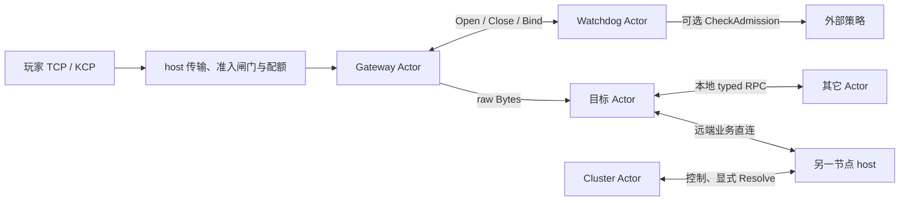

# 服务端架构

`kernel/` 只放通用宿主机制：`host/` 核验和驱动实例、管理身份；`abi/` 定义插件边界；`local/` 负责稳定对象的布局、所有权和释放。kernel 不等于零依赖：host 可使用纯帧／地址包，但不链接 SDK、角色协议、业务 schema、具体 codec 或三种默认服务。增加业务、替换角色或选择编码器，优先在 `services/`、`sdk/`、`protocols/` 完成；只有通用机制确有需要才修改 kernel。



上图是运行时数据路径；下图箭头才表示编译依赖。每种角色的实现、协议和默认入口是三个独立的 Cargo 包；同目录归类不等于合并包。`plugin/` 编译的动态库由启动配置选择，不是 host 的链接依赖。

```text
services/<role>/plugin → services/<role>（泛型实现） → 所需 services/<role>/protocol
                                                   → sdk ─┬→ kernel/abi（native）
                                                          └→ protocols/codec
kernel/host → kernel/abi（native） → kernel/local → abi_stable
            → protocols/net、kernel/transport（共享原生 KCP 消息适配）
tools/test-client → kernel/transport、protocols/example、protocols/net、protocols/codec（不依赖 host/SDK）
```

`<role>` 仅为 gateway、watchdog、cluster。`tests/fixtures/` 不是第四个内置角色。以上各包仍属于同一个根 workspace。

| 层 | 当前能核对的行为 | 尚不提供 |
| --- | --- | --- |
| 纯协议 / codec | 8 字节服务地址、公共／内部帧预检与解析、分域固定引导；typed 方法静态装配、有界 ace packed、双向 golden | socket、KCP 核心驱动与连接状态机 |
| host | 装载、持久发号、每实例唯一的多线程可迁移 driver；本地路由、pending/完成/额度、动态管理、timer、终态订阅，按 owner 分发的 TCP/KCP socket 事件以及有代次的节点 TCP 数据路由 | 成员算法、玩家准入策略 |
| SDK | `Actor<S>` 驱动有界 Send Future；typed/raw 调用、自动回复与 ticket Future；独立的请求/响应表示，捕获回调 panic 并专用取消 | 网络角色的业务实现 |
| 服务 | `Gateway<C>` 双传输路由、`Watchdog<C>` 准入及绑定、`Cluster<C>` 单 seed 目录、重连和显式远端解析；三个默认薄库选用 AceCodec | 生产登录鉴权、运行中换库 |

`config/server.toml` 将实现文件、实例/别名、角色、特殊入口授权、预算和 create/prepare/start 顺序分开。角色可由多个兼容实例承担；节点控制权只授给一个配置实例，不随角色名自动转移。`inspect-manifest` 解析有大小上限的 TOML，校验动作顺序，再对照实际库核对角色版本和 codec；只检查，不创建实例或端口。

流程：宿主启动 → 用上游基于 libloading 的入口映射每个文件 → 核验布局与角色 → 允许用已装载实现创建实例。Prepare、Start 和宿主管理方发布全部完成前拒绝普通消息。Pending 可接收该动作所属的监听、节点控制等依赖事件，只能经匹配的生命周期 poll 收尾。Stopping 的有限终结通知走专用清理入口；Faulted 连该入口也跳过。插件取消和最终析构之间留给宿主清理额度，二者均不恢复普通 Future。详见[实例阶段与所有权](plugin-abi.md)。节点运行时驱动这些片段；全局步骤另由[部署配置](#部署与有界关闭)决定。

## 本机 Actor 与管理

[`Node::start`](../kernel/host/src/runtime/mod.rs) 在已装载的实现与既有 `Identity` 上运行；`inspect-manifest` 不调用它。`run-manifest` 由同步管理线程持有一个 Tokio 多线程 runtime。每个已预留实例仅有一个 Send driver；它独占 `loader::Instance`，不会在源服务的调用栈派发目标事件。发号的文件同步走有限实例数约束下的 blocking 工作，插件回调本身必须短且不阻塞。回收前会等待 driver 的终态，不依靠丢弃 JoinHandle 取消。

- 每个业务 mailbox 使用 `ArrayQueue`，同一 driver 是唯一消费者。准入/停止用短账本临界区裁决；**不是整条路径无锁**。独立的 `Notify` 唤醒只提示重新检查，真实消息、完成、timer、管理和订阅有各自的有界记录。队首 send 遇入站任务满时保留，不反复尝试；request 可以异步终结为 Busy。每轮最多推进一个业务输入、一个优先控制事件以及一批实际 Future poll。
- `[budgets]` 分别指定 `mailbox_entries`、`payload_bytes`、`task_slots`、`polls_per_turn`。可选 `workers`（默认 2）、`instances`（128）、`control_slots`（每实例每类 64）、`timeout_ms`（30 000，RPC/初始化和单次 timer 参数上限）。这些是本地起步值，不是吞吐目标。还限制配置的总邮箱槽/控制槽乘积及总负载预算，防止一份很短的清单要求超大预分配。固定元数据和受管负载分别限额，不把进程 RSS 解释为配额。
- 配置实例的 `manage = ["实现键", ...]` 是本地 create/stop 范围，默认空；动态实例不继承创建者的能力。`prepare_dependencies` 在 Prepare 中允许解析已创建的指定依赖地址并订阅其本地终态，不授予提前投递权。别名在创建前预留；动态结果可通知但不等于交付，`create_service` Future 最后一次 poll 成功认领后才看到 Running 地址。drop、创建者先停、动作失败/超时均不会发布未认领实例。停止后再次创建得到新地址。
- deadline 和普通 timer 使用 Tokio 单调计时，无每次 RPC 单独 spawn 的超时任务。一个 timer 只保留一个到期记录；周期漏过多次不补发一串事件。后台可撤销的 `Timer::tick()` 与 raw 控制事件都按代次核对。订阅本地实例时重复登记同一目标合并；未取消且仍存活者收到一次终态，正在终结可取得快照，已回收返回 NotFound。
- `Node::reply_port` 是**受本机管理方控制的有限字节入口/回复出口**，不是网络准入。一次入站绑定端口代次、源节点／地址、目标、会话、方法与期限。成功出口满时 SDK 保留本次编码结果、等待合并的 `ReplyWritable` 或期限，不重跑 handler；无体错误另占预留槽。它与 socket 有独立预算，也不冒充节点路由。真实 listener、代次、输入及出口见[原生传输](transport.md)。

[可运行清单](../tests/fixtures/runtime.toml) 使用三个真实实例、两份测试实现，并非三个内置角色。工具与故障断言见 `tools/smoke-abi.sh` 和 `kernel/host/src/runtime/tests.rs`。并行屏障、环形槽复用或 codec 计数不能当作吞吐／延迟比较。

```text
多个生产者 → host 额度 / 实例阶段 → 业务 mailbox ─┐
完成、timer、终态 → 各自有界记录 ──────────────┼→ Notify → Tokio 可运行的唯一 driver
                                                └─ 锁外进插件 → 有界 Send Future 集
一次 poll Pending → driver 可取下一条输入；Waker 只标就绪 → 下一轮在任意 worker 串行推进
```

本地选路先核对方法、codec 三元组和双摘要。宿主对两端注册的请求／响应布局分别做双向兼容检查；同一对已装载实现、同一方法和回复模式复用选路结果。它不是投递许可：提交时仍须核对活实例、入口权限、实际对象的声明与容量，并预留 pending／回复额度，再移动对象或接纳字节。结果经唯一 reply token 回到 caller 的完成槽，不在调用栈重入。远端先 `Resolve(node, alias)`，两向均走 Bytes：源 host 有界出口 → 目标 host 独立申请邮箱和回复槽 → 目标 Actor → 原 peer 代次回复。控制器不代理业务。见[完整选路及计费](plugin-abi.md)和[节点路由](cluster.md)。

## 部署与有界关闭

默认[清单](../config/server.toml)先启动成员控制器和业务，再准备 Gate、建立 Watchdog 对精确 Gate 的终态订阅，最后启动 Gate。先等两监听，再由总清单的发布开放接入。运行中的配置由一次 `run-manifest` 固定，不做在线重载。`[shutdown]` 的两组**清单别名**各自按顺序停止：

```toml
[shutdown]
first = ["gate"]
last = ["sessions", "members"]
cancel_after_ms = 4000
timeout_ms = 5000
stdin_stop = true
```

`first` 与 `last` 之间是未列出的业务／策略及已认领的动态实例，按预留顺序的逆序收尾。未认领子实例也会回收；拥有者先停或其初始化期限先到时可以先行作废。动态实例即使用了一个已退役清单实例的旧别名，也在中间组。不按角色名猜顺序，操作者须用实际 alias 把接入放在前、依赖其清理的控制器放在后。重复／未知别名、非 `0 < cancel_after_ms < timeout_ms ≤ 60000` 均在装载前拒绝。省略本节时，两个列表为空，保留逆序及 stdin 行为，期限默认如上。无信号的失败启动按预留逆序回滚，不发布半节点。

1. CLI 在读完清单后、装载库及创建 runtime **之前**屏蔽进程的 SIGTERM；专用线程同步接收它，不依靠被阻塞的 Tokio worker。启动等待也可被打断。信号、发布后的 stdin 字节／EOF、节点析构复用一次单调期限，不随别名、重复信号或重试而重新计时。
2. 在账本撤销 ready，拒绝新创建、未交付 ticket 的认领、外部会话及业务接纳。已在锁外的一个片段不能抢占；不再启动下一段普通 handler。依序停 Gate 的监听/活连接；尚未轮到的 Watchdog 可收 Gate 的 `ResourceGone`，成员控制仍可处理清理。接着停业务／策略、Watchdog，最后 Cluster 的链路及路由。每个 driver 的 Cancel、额度回收、destroy 仍按[实例顺序](plugin-abi.md#哪些回调可进实例)执行；所有 Gone 后才关闭 runtime。
3. 到 `cancel_after_ms` 仍未结束顺序收尾时，剩余实例进入 Faulted：停止普通清理，由**原 driver** 专用取消任务、释放资源和析构；即使在硬期限内返回，命令也报告超时、非零退出。到 `timeout_ms` 仍不能退出（如 native 回调不让出），独立期限线程对**本进程** fail-stop，不从另一线程 destroy，不报告已排空。服务管理器应留出超过硬期限的停止窗口。

`kill -TERM "$host_pid"` 仅对本次启动、记录 PID 的专用进程使用。服务管理器通常将 stdin 接到空设备，此时设 `stdin_stop = false`；默认在发布后才读标准输入，不会用阻塞 stdin 卡住 SIGTERM。CLI 独占本进程的 SIGTERM；从正常信号处置启动，受信 native 不得更改掩码或处置。日志出口须能持续写入，截止时间不是实时调度保证。正常退出是有限清理、不是处理完全部业务、更不是对端收到最后一包。用 `python3 -B tools/player-smoke.py target/release --case shutdown` 实际发送 SIGTERM（须先有 release 产物和 `runtime_echo` 示例；`sh tools/smoke-abi.sh` 自动构建并执行）。

## 默认玩家路径

[`config/server.toml`](../config/server.toml) 启动 seed 和样例业务 target，随后 Gate Prepare。Watchdog 在 Prepare 按 `gate_alias` 解析被显式授权的本地依赖，确认该地址部署了兼容的 Gateway、有玩家入口授权，且双方支持所需的 Open/Close 和 Bind/Kick，才订阅其终态并完成 Start。Gate 在 Start 按 `watchdog_alias` 核对实际 Running 的 Watchdog、双向方法及**该 Watchdog 对本 Gate** 的有效订阅，成功才申请 TCP、KCP。别名不必等于角色名；另一个同角色实例的订阅不能代替这项检查。宿主只执行[通用启动检查](plugin-abi.md)，不解析具体角色或服务私有配置。

两个 `ListenReady` 只表示该实例的两次绑定成功；宿主在所有清单动作成功、各实例仍运行后才允许玩家接纳。对端检查失败、订阅满或任一监听失败均不发布，先前绑定的 socket 随失败启动一并收回。

1. Accepted 后 Gate 向它配置的 Watchdog 单向发送 `Open::Accepted`。首个应用帧须为公共 `Admission`；Gate 只解码此握手，向同一 Watchdog 提交 `Open::Handshake`。`admission_policy_alias` 缺席时仅接受示例 token `demo` 并使用 `default_target_alias`；存在时先 await `CheckAdmission`，只有 `Admitted{target}` 允许提交 `Bind`。超时、拒绝、策略不可用都关闭，不回退 demo。一次准入的 timer 在绑定、拒绝或提前断开时撤销。
2. Gate 只接受配置 Watchdog 对**本代待准入连接**的 Bind，以及对本代连接的 Kick。本地目标先成功订阅终态，再建绑定；远端不建本地订阅，只在得到 `Stopped`、`NotFound`、`Unreachable` 等终态后关闭。`Online` 统计本 Gate 已接纳且尚未进入关闭的连接，仅允许配置的 `online_aliases` 查询。
3. 已绑定的 Data 经 SDK 的有界 `network_data` / `raw_call` 或 `raw_send` 提交。Gate 不改业务方法、codec、双摘要和 body。`Entry::Player` 来自获授权的服务 context；目标 descriptor 必须允许客户端方法。普通 handler 自动回复后，Gate 核对 `(conn, generation, client_session)` 和原绑定，经同一受控出口还原 session。重复活跃 session 关闭连接；过期／其它代次结果不能认领新请求。失败响应无 body；出口已满即关，不另排无界字节。单向 send 无回执。显式 `SendToSession` 只接受实际绑定目标以 Gate 签发的推送令牌提交的公共单向帧，不代替请求响应。
4. TCP FIN、KCP 的本地终结／idle 均产生同类 Closed。Gate 撤销关联，但在 Watchdog 真接纳 `Close` 前保留宿主原连接槽：Busy 只暂拒本轮，独立的有限周期事件允许继续重试，不按重试总数或截止时间丢记录。接纳或发现 Watchdog 已终结后显式 `net_release_closed`；Gate 自身停止不再发普通业务，由 Watchdog 的 `ResourceGone` 批量清理，晚到旧 Open 不建新会话。正常停止可进专用清理，Faulted 不进业务清理；宿主均兜底回收。

默认 Watchdog `max_sessions=64`，`admission_timeout_ms=3000`；Gate `bind_timeout_ms=5000` 限制待绑定停留时间，即使 Watchdog 的 Kick 也遇限额，未绑定者不会永久占用槽。这些配置与宿主网络连接、RPC 任务／字节、timer／订阅限额独立。示例准入不是生产鉴权；进程收尾由宿主管理方编排。角色替换和策略选择另由独立实库复用上述路径验证。

## 动态节点

[受管节点与远端调用](cluster.md)说明默认 Cluster 的实际配置及状态转换。host 的 peer 控制资源与外部玩家 socket 分域；从固定握手到本代路由都使用同一 runtime，服务回调仍在唯一 driver。`Resolve(node,alias)` 由可替换角色处理；之后每条业务 send/call 走两端 host 直连及目标 Actor。`Node::reply_port` 的本机管理入口不建立远端身份；已准入 socket 使用专属的同类有限回复出口。

## 线上帧：解析不等于准入

`ace-net-proto` 不依赖业务 codec 或 native。首版公共业务头共 **104 字节**，无填充。下列整数均逐字段小端读写，摘要按原 32 字节顺序写入，不复制 Rust 结构内存：

| 偏移 | 字段 |
| --- | --- |
| 0 / 4 / 6 / 8 | `frame_rev:u32=1`、`flags:u16`、`kind:u16`、`status:u32` |
| 12 / 16 / 20 / 24 | `method_key:u32`、`codec_id:u32`、`codec_rev:u32`、`options_id:u32` |
| 28 / 60 | 请求、成功响应 SHA-256；单向的响应摘要为零 |
| 92 / 96 | `body_len:u32`（实际线上字节数）、`session:u64` |

公网 flags 必须为零。`kind=1` 单向：session/status 为零、无扩展；`2` 请求：session 非零、status 为零，追加 `max_response_bytes:u32, timeout_ms:u64`；`3` 响应：回显 session，无请求扩展。超时是有限非零相对毫秒，不比较跨机时钟；上限可拒绝，零响应容量合法。成功响应 status 为零，body 可以为空；失败响应只能是 `RpcError` 的十种非零终态，body 必须为空。错误只核验方法和关联身份，不调用业务 codec。方法键零保留；非错误要求非零请求摘要，请求／成功响应还要求非零响应摘要。

节点路由使用 `0x101..=0x103`，在请求扩展（如有）后追加 `source:u64, destination:u64`。仅路由请求／单向可置 `flags=1`，再追加源 Gate 的 `push_session:u64`（零表示没有）；普通服务间消息和节点响应不带它。`0x201` 是绑定 peer 连接的单向控制，无地址、无推送令牌。玩家的 `Frame::from_player` 不接收内部种类、标志或响应；改写公网 body 也不能改变信封的来源。宿主仍须核验连接 owner、路由两端、代次、调用权限和 client-callable 白名单。session、推送令牌、业务地址与本机 reply token 不互换。

`Frame::inspect` / `NodeFrame::inspect` 只读固定头及扩展，先核对域、关系、限额，返回方法、session、body 长度与完整帧长。输入可先用 typed 方法的 `check_input(head.wire, head.message)` 检查方法身份和方法允许的预留；响应用头的 `check_response` 对照该次请求的预留，再取得 body 空间。完整 `decode` 要求输入长度恰好匹配且只借用 body；packed 字节不按 raw 内部长度推算。帧的修订与本机 ABI 及每个 body 的 codec 各自比较。

`bootstrap` 中的记录都使用相同的八字节修订／flags／kind 前缀（flags=0），不走业务 decoder：

- 公共 `Hello`（`0x10`）带必需能力 `u32=1`（每方法双摘要），不是全连接 codec 协商或 demo 准入令牌。
- `PeerHello`（`0x110`）带发送节点／启动号、发起节点／启动号和尝试号，宽度依次为 16/64/16/64/64 位。`PeerReady`（`0x111`）无扩展。候选身份和就绪记录本身不授予路由。
- KCP `Hello/Offer/Confirm/Ready/Data` 分别为 `0x301..=0x305`。前四种含非零 nonce:u64；除 Hello 外含非零 epoch:u64、token:u64、conv:u32。Data 无 nonce，28 字节头后是一份非空 KCP 报文。UDP 总预算含外层；纯帧包不实现随机数发放、重试、KCP input 或认证。原生适配器复用这些外层字节；一条消息可以由许多 UDP 报文传送。

## 方法、codec 与本地表示

示例及各 `services/<role>/protocol` 中的 `schema.rs` 提交规范 UTF-8 字节（不追加换行）及其 SHA-256，不按 Rust 类型名或反射生成。规范中的 `/1` 是语义修订，`n:name:type` 是编号和逻辑类型；`!` 必有，`=0` 表示缺席时取零，`seq(T)` 是按序的有数目集合，变体显式编号，嵌套类型展开。默认 ace 对象按编号写槽，零标量可省略，字符串为 UTF-8，集合记录为 u32 数目及元素；使用 packed envelope。选择其它格式可改变物理编码，但不改变字段语义，**三元组与两个摘要都必须比**。业务地址字段为 16+48 地址的线上 u64；解码一份角色 DTO 不验证地址活性或授权。

| 接口（角色修订均为 1） | 键／方向 |
| --- | --- |
| Gateway | 257 Bind、258 Kick（Watchdog → Gate）；259 SendToSession（绑定目标 → Gate，内含原始公共单向帧）；260 Online（管理方 → Gate）。都是调用。 |
| Watchdog | 513 Open、514 Close 是 Gate → Watchdog 的单向消息；515 CheckAdmission 是 Watchdog → 配置策略的调用，回复分 Admitted / Denied / Unavailable。 |
| Cluster | 769 Join、770 JoinResult 是引导单向控制；771 Members、772 Leave、773 Heartbeat 只用于已准入 peer 的单向控制；774 Resolve 是有成功响应的服务调用。 |
| 公共示例 | `0x401` Admission 是 Gate 接收的演示单向握手，不是生产鉴权。`Open::Accepted` 带 Gate 观测的连接／端点，`Open::Handshake` 只在该代连接上转交握手给 Watchdog，不用玩家 session 或推送令牌作连接身份。`0x402` Echo → EchoReply 是面向业务服务的调用。 |

`TypedMethod<C,Q,R>` 按 DTO 静态约束 `Codec<Q>` 和（有成功响应时）`Codec<R>`。例如 `ace_example_protocol::echo::<C>()` 同时决定客户端编解码和服务声明。只声明 `Format::ID` 不能构成角色实现。SDK 默认 feature `codec_ace` 导出 `AceCodec`；三个默认薄库选择它。协议包只在 `codec_ace` feature 下使用 ace 派生；`default-features=false` 的服务可使用自己的 codec 和同一角色 Rust 库，不引入 ace trait 或运行时 codec 插件。

默认 `[1,1,1]` 适配调用锁定版本的 `ace_serialize::encode_into` / `decode`。目标和 scratch 由调用方给出；只有成功后才交出有效长度／切片，失败后的缓冲不能发送。`Limits::default()` 的实际 wire 上限为 64 KiB、解包及累计物化各 1 MiB、深度 32、单集合 4096 项，其余上游计数预算仍有限。不同输入所需 scratch 不同；上游 `InvalidArgument` 也可能表示目标／工作区不足，适配器保留该错误，不推断准确的缺口或自动换格式。这些上限不等于对任意用户 codec 的内存沙箱。

`bytes_method` 从 typed 方法映射到冻结的 native 声明。`local_call` 可为可选的稳定服务侧表示增加真实布局和独立的本地成功预算。例如 Bind/Kick 和 Ack 可直接移动；`protocols/example` 的 `local` feature 把 Echo/EchoReply 的 Vec 移到各自的稳定 RVec 表示，递归容量另计。布局选择与释放仍走[同一逐方向规则](plugin-abi.md)；玩家桥接没有本地对象，普通客户端无需 native 依赖。

## 节点身份

`identity::provision_new` 是**首次**配置未用节点号的显式操作；`Identity::open` 只打开既有目录。持锁的是目录，不是会被原子替换的水位文件。记录含版本、节点、高水位及 SHA-256；同目录临时文件写入并同步、原子替换、同步目录，成功后才发号。重新打开跳过上次预留的整段，创建失败也不归还号码。

部署必须保护节点号唯一及身份目录完整，不能复制、回滚或在运行期间替换该目录。校验和能发现损坏，不能识别一份完整但过期的备份。存储不遵守同步语义或状态丢失时不能保证不复用，应重新分配未用节点号；测试不是断电持久性认证。

## 验证边界

`tools/abi-smoke` 与 `tests/fixtures/{caller,echo}` 检查同一选择算法的跨库所有权、布局漂移、字节回退及真实编解码次数。宿主示例 `loader-check` 另外装载三默认角色与测试策略库，检查版本拒绝、初始化、隔离与收尾。夹具不是第四个内置角色。完整目标与非目标见[需求](requirements.md)。

`sh tools/smoke-abi.sh` 还用同一 release host 分别装载默认库和 `Cluster<FixedCodec>` 薄入口与匹配的 Echo 夹具；同一 loader 驱动向实际服务表投递客户端产生的帧体，再将插件编码的响应交回客户端。禁默认的替换件独立构建。这个文件交接试验不启动 socket、不构造完整 RPC 运行时，不等于三角色替换后的网络验收。

[`tools/role-smoke.py`](../tools/role-smoke.py) 在这些回归之外固定一份 host 和三默认库，按清单**每次只换一个**，并分别启动玩家和成员回环。外部策略由默认 Watchdog 选择；KCP 的策略超时由 Watchdog 的准入期限触发，不把对端等不到应用回复或普通传输 idle 当作拒绝证据。整组固定字段 codec 的验证同时保留本地 Bind/Ack 的零编解码、只支持 Bytes 的兼容角色对端、两端实际计数和跨节点请求／响应。产物与部署命令见[替换与 codec 装配](#替换与-codec-装配)。

## 替换与 codec 装配

`libraries` 决定启动时装载的文件基名，`implementation` 是该库声明的实现键，`role` 和 `grants` 分别决定角色与授权。保持 alias 或同步更新引用它的配置；重启部署，不支持热换。以[薄库示例](../tests/fixtures/policy/examples)为例：

| 文件基名 / 实现键 | 独立替换的行为 |
| --- | --- |
| `bounded_gateway` / `example.bounded-gate` | 取代 `ace_service_gateway` / `gateway`；保留普通自动回复，路由前关闭超过 256 字节的玩家帧。 |
| `policy_watchdog` / `example.policy-watchdog` | 必须配置外部策略；Bind 请求及 Ack 只宣告 Bytes。 |
| `export_cluster` / `example.export-cluster` | 本机别名照常解析，只对远端导出 `echo`。 |

只替换策略时**不用换任何角色库**：先启动实现 `CheckAdmission` 的外部实例，给 Watchdog 配 `admission_policy_alias` 指向它。换 codec 则**不能只改 TOML**：`fixed_gateway`、`fixed_watchdog`、`fixed_cluster` 用同一生产角色实现装配[固定字段 codec](../tests/fixtures/codec)，业务、角色调用方和 CLI 必须匹配。`python3 -B tools/role-smoke.py` 按阶段构建、固定并逐项复核部署产物。可用 `--base-release <只读 release 目录>` 指定同布局且支持本版清单的 host／三默认库，`CARGO_TARGET_DIR` 须为独立目录，`--results <已有目录>` 指定结果父目录。

确切请求／响应见 [`golden.txt`](../tools/test-client/golden.txt)。样本数据为 ASCII `ACE`；默认 packed body 25 字节，夹具 `[0xf17,1,0]` 的 body 是 `03 00 00 00 41 43 45`。可在本仓根用公开 ace-serialize 提交 `4a18e69aef27d79c155a30bec4b13abb16c635b2` 的 Python 参考模型复核，不调用 Rust 产物，也不修改预期文件：

```sh
python3 -B tools/test-client/golden.py "$SERIALIZE_CHECKOUT/tools" | diff - tools/test-client/golden.txt
```

## 同机测量

从仓根执行 `results=$(mktemp -d); python3 -B tools/measure.py --results "$results"`。需要至少两个可用核；用 `--workers N` 指定多 worker 对照（2–8，不超过进程可用数，默认至多 4）。可另设 `CARGO_TARGET_DIR`。不需要玩家端口或第三方服务。脚本逐个用新进程运行，打印机器、工具链、各 case 指标和退出码，保留生成清单、原始 `result.log` 与单独的 DTO 对照。调度、系统负载与分配器都会影响结果，不在 CI 比速度。

**端到端本地 RPC**：release 实库、真实 Node、邮箱、ABI 和所有权账本。4 个同步生产者各经有限管理端口提交 8 字节命令；caller 调 typed 方法并等 echo 自动回复，最后把 8 字节结果交回端口。单实例是 echo 自调用；均匀／热点用同样 4 caller + 4 echo，分别发给各自的 echo 或同一 echo。每实例邮箱／任务／控制各 128，预算 128 KiB、每轮最多 16 polls；每端口最多 8 条在途，内部成功回复预留 1024 字节。DTO 为 `u64 + 6 字节 UTF-8 + 3 × u32`，本次 Bytes 成功编码 46 字节。禁用夹具的人为延迟和逐请求日志，不禁用正式检查。每组先热身 32，然后计时 32,768 份**完成的往返**，逐份从提交前到出端口记单调时延，再取最近秩 p95/p99。

示例：Apple M4、10 物理／逻辑核、macOS 15.7.3 arm64、Rust 1.98.1、Tokio 1.54.1、默认 ace，未绑核。每格为 **完成/s；p95/p99 µs；进程 CPU %**（100% 约一核，包括生产者）。一轮快照，不是产品承诺：

| 负载／路径 | 1 worker | 4 workers |
| --- | ---: | ---: |
| 单实例 LocalOwned | 7,496；4,379/4,623；86 | 8,382；3,862/3,981；106 |
| 单实例 Bytes | 27,284；1,205/1,286；46 | 62,296；523/595；142 |
| 均匀 LocalOwned | 7,830；4,096/4,203；99 | 15,164；2,309/2,721；279 |
| 均匀 Bytes | 50,584；635/687；91 | 51,982；646/728；309 |
| 热点 LocalOwned | 7,515；4,307/4,474；94 | 11,541；2,812/2,898；191 |
| 热点 Bytes | 36,975；877/932；67 | 44,684；737/835；276 |

四 worker 均匀 LocalOwned 用时 2.161 s，四个 worker 的 Tokio 忙时间占比分别为 91.6/91.8/91.9/91.7%，采样的全节点排队／pending 峰值 32/45；Bytes 为 0.630 s、87.7/87.6/87.5/87.5%、29/39。忙时间含 worker 在任务内的等待，**不是**该 OS 线程 CPU 时间；进程 CPU 由系统进程时钟直接读取。排队每生产者每 32 批采一次，不是绝对高水。均匀负载用到了四个 worker，不能据此推断线性加速。热点 LocalOwned 有一个 worker 忙 99.3%，其余各约 27%；增加 worker 不会把同一 echo 的 driver 拆开并行。

LocalOwned 两库实际编解码均为零；均匀／热点 Bytes（含预热）每库各 32,800 次 encode 和 decode，单实例在同库累计为两倍。这组小消息仍是 Bytes 完成得更多、p99 更低。注册声明的选路结果可复用，具体对象仍要核验、移交和记账；端到端测量不拆分各步耗时。单列同一 DTO 的转换：预构造输入、预留外层数组，32,768 项 `into_stable` 所有权移动平均 21.92 ns/项；`from_stable` 物化普通字符串和向量平均 90.50 ns/项，稳定本体 72 字节、拥有的堆容量 18 字节。不含 ABI、布局核验或批末析构，不能从端到端延迟简单相减。

**只比队列后端**：没有插件、RPC 或生产账本。4 个生产者、4 workers、1 或 4 个唯一消费者，各队列 32 槽（32 字节内联负载，1 KiB 负载上限，本机完整元素 64 字节；不等同于两实现的总分配）。每生产者 50 次定时突发、间隔 20 ms、每次 256 条；同一秒投放 51,200 条并收完，过载不截尾。每生产者序号与负载逐条核对，满时保留同一条再等空间。时延从首次提交尝试到取出；这个固定到达率的结果不是队列的极限吞吐。

| 后端／分布 | 完成/s | p95/p99 µs | 进程 CPU % | 观察到 Full 次数 |
| --- | ---: | ---: | ---: | ---: |
| ArrayQueue + Notify／均匀 | 50,964 | 12/36 | 2.1 | 1,406 |
| bounded mpsc／均匀 | 51,043 | 10/34 | 1.9 | 1,413 |
| ArrayQueue + Notify／热点 | 50,967 | 23/39 | 3.9 | 3,637 |
| bounded mpsc／热点 | 50,940 | 32/48 | 4.7 | 4,295 |

四组都观察到占满 32 槽；Full 是各自尝试次数，并非丢包数。本轮热点下环形对照的进程 CPU、p95 和 p99 均较低，均匀负载下则较高；不能据此判定哪种后端普遍更快。正式后端仍用 ArrayQueue + Notify：独立的实库回归验证多轮复用、无丢失／重复、满槽回滚、停止竞争、入睡间隙 wake 及任务饱和时不自旋；这不是严格 lock-free 或实时进展证明。两类对照都不是跨实体机或玩家网络基准。
